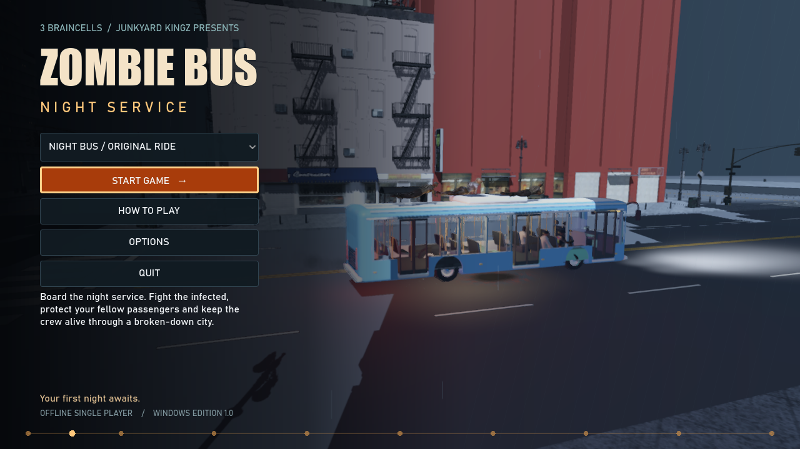
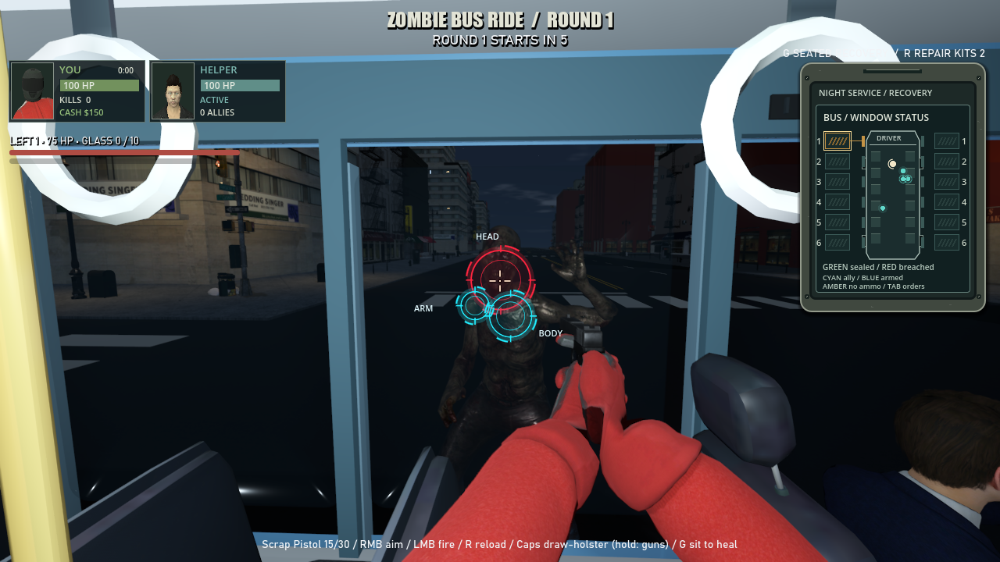

# Zombie Bus: Night Service

An offline Windows survival game aboard the last bus through New York City.
Protect your passengers, earn cash, visit the gun shop and keep the bus running.

## Download for Windows

### [Download the Windows game ZIP](https://github.com/astroblitzcreations/Zombie-Bus-Night-Service/releases/latest/download/Zombie-Bus-Night-Service-Windows.zip)

Extract the ZIP, then double-click **Zombie Bus.exe**. The game data is inside the EXE.
Godot, a launcher, an account and an internet connection are not needed to play.

Windows 64-bit · Single player · Two modes

## Pick your ride

- **Zombie Bus Ride:** survive five rounds and the final escape while protecting your fellow passengers.
- **Barricade Run:** fit window boards, coordinate passengers and fight the infected as they tear through the defenses.

The NYC route includes a helper, passengers, weapons, weather, voices, cash rewards,
an armor-and-wall-gun supply shop, breakdowns and emergency exit/reboarding.
Options, tutorials, pause/restart, saved settings and best scores are included.

## Controls

| Action | Control |
| --- | --- |
| Move / sprint | WASD / Shift |
| Look | Mouse |
| Aim or guard | Hold right mouse |
| Fire, attack or fit a board | Left mouse |
| Gun / fists | Tap Caps Lock |
| Owned-gun dial | Hold Caps Lock |
| Reload | R |
| Stand / sit and recover | G |
| Interact, board or rally a frightened passenger | E |
| Emergency door / share a weapon | F |
| Repair kit during a breakdown | R; Shift+R reloads |
| Passenger orders | Tab |
| Change camera | V / C |
| Skip introduction | Enter |
| Pause / fullscreen | Escape / F11 |

Start with the loaded pistol selected. The bus waits for you during an emergency stop.
Settings and records are saved locally. Controls and sensitivity can be changed in Options.

## Build notes

This build includes corrected weapon hands and hit detection, a crosshair and combat rings,
the palm-facing passenger rally interaction, walking seat returns, cone-hat removal,
the loading-audio and standing-performance fixes, nighttime showroom lighting,
and a looping introduction with zombies clinging to the bus roof.

[Release notes and checksums](https://github.com/astroblitzcreations/Zombie-Bus-Night-Service/releases/latest)

Asset credits and third-party notices are available in **Options → Game → Asset Credits**.
